 

 

<h2 align="center">Sobre mim</h2>

<em>Transformo problemas do dia a dia em soluções com código.</em>

Sou estudante de Engenharia de Software e desenvolvedor em formação, com foco em **Python**, **automação** e **Inteligência Artificial**.

- **Já construí:** um chatbot com IA que responde perguntas a partir de documentos PDF e projetos em grupo com Python, SQLite e Git, como um sistema de estoque e um conversor de temperatura.
- **Estudando agora:** backend, banco de dados e boas práticas de engenharia de software.
- **Objetivo:** entrar em uma equipe de tecnologia, ganhar experiência profissional e construir soluções inteligentes para problemas reais.
 
 

<h2 align="center">Tecnologias e Ferramentas</h2>

  

 

<h2 align="center">Projetos em destaque</h2>

<table>
  <tr>
    <td width="50%" valign="top">
      <h3><a href="https://github.com/arthurxfe/chatbot-especialista-pdf">Chatbot Especialista em PDF</a></h3>
      
Chatbot com IA que responde perguntas com base em documentos PDF.

      

        
        
      

      Projeto individual · <a href="https://github.com/arthurxfe/chatbot-especialista-pdf">Ver repositório →</a>
    </td>
    <td width="50%" valign="top">
      <h3><a href="https://github.com/Raiane19/projeto-gerenciador_estoque">Gerenciador de Estoque</a></h3>
      
Sistema com login (senha com SHA-256), CRUD de produtos, entradas e saídas e alerta de estoque baixo.

      

        
        
      

      Projeto em grupo · <a href="https://github.com/Raiane19/projeto-gerenciador_estoque">Ver repositório →</a>
    </td>
  </tr>
  <tr>
    <td width="50%" valign="top">
      <h3></h3>
      
Menu interativo com 6 conversões entre Celsius, Fahrenheit e Kelvin. Minha parte: Fahrenheit ↔ Kelvin.

      

        
        
      

      Projeto em grupo · 
    </td>
    <td width="50%" valign="top">
      <h3><a href="https://github.com/arthurxfe/desenvolvimento-de-algoritmo-e-pensamento-computacional">Algoritmos e Pensamento Computacional</a></h3>
      
Exercícios e desafios de lógica e algoritmos.

      

        
      

      Projeto individual · <a href="https://github.com/arthurxfe/desenvolvimento-de-algoritmo-e-pensamento-computacional">Ver repositório →</a>
    </td>
  </tr>
</table>

 

<h2 align="center">Atualmente estudando</h2>

  

 

<h2 align="center">Estatísticas</h2>

  
  

 

<h2 align="center">Contato</h2>

[LinkedIn](https://www.linkedin.com/in/arthur-ribeiro-a2581540b/) · [ribeiro.arthur595@gmail.com](mailto:ribeiro.arthur595@gmail.com)

